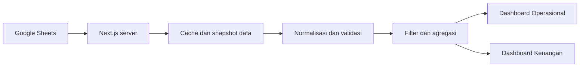

  <h1>Petak &amp; Solar</h1>
  
Dashboard monitoring operasional excavator dan keuangan petak.

  
<strong>Next.js</strong> · <strong>TypeScript</strong> · <strong>Google Sheets</strong> · <strong>Recharts</strong>

---

Petak & Solar menyatukan pemantauan aktivitas petak, konsumsi solar, jam kerja alat, dan ringkasan keuangan dalam satu dashboard.

## Dashboard

| Tampilan | Fungsi |
| --- | --- |
| **Operasional** | Memantau petak, pengisian dan pemakaian solar, HM kerja, efisiensi, status pekerjaan, serta target luas bulanan. |
| **Keuangan** | Menampilkan pendapatan kotor sumber, biaya solar terverifikasi, margin setelah biaya solar, serta estimasi harian atau bulanan berdasarkan HM. |

Kedua tampilan menyediakan filter periode, SPK, dan kode petak. Dashboard juga menyediakan rincian petak dan panel kualitas data untuk membantu meninjau nilai yang hilang atau tidak konsisten.

## Teknologi

| Teknologi | Peran |
| --- | --- |
| **Next.js & React** | Struktur aplikasi, navigasi, dan antarmuka dashboard |
| **TypeScript** | Model data dan pengembangan aplikasi |
| **Tailwind CSS & shadcn/ui** | Styling dan komponen antarmuka |
| **Recharts** | Visualisasi data dan grafik interaktif |
| **Google Sheets API** | Pembacaan data operasional dan keuangan |
| **Google Service Account** | Autentikasi akses spreadsheet di server |

## Konsep arsitektur

Server membaca worksheet melalui Google Sheets API dengan akses **read-only** dan menyimpan snapshot dalam cache. Data kemudian dinormalisasi, divalidasi, dan diagregasi untuk menyajikan KPI, grafik, tabel, serta temuan kualitas data. Filter bekerja terhadap snapshot yang telah diterima dashboard.

Integrasi menggunakan dua worksheet:

- **`Overview Operasional`** — aktivitas petak, solar, HM, dan status pekerjaan.
- **`Overview Finance`** — nilai dan biaya per SPK/petak, yang dihubungkan dengan data operasional menggunakan identitas yang dapat diverifikasi.

## Cakupan data

- Aktivitas operasional mengikuti rentang tanggal; inventaris petak dibedakan dari aktivitas dalam periode.
- Nilai keuangan sumber merupakan **snapshot tanpa tanggal transaksi**. Subtotal dengan data belum lengkap ditandai sebagai parsial.
- Grafik estimasi keuangan menggunakan proporsi HM dan **bukan transaksi atau penerimaan kas aktual**.
- Target luas ditetapkan sebesar **60 ha per bulan** dan menggunakan luas terverifikasi dari petak yang selesai pada bulan terpilih.
- Waktu sinkronisasi ditampilkan dalam zona **Asia/Makassar (WITA)**.

Kredensial Google Sheets disimpan di sisi server. Aplikasi belum menyediakan autentikasi pengguna, sehingga kontrol akses perlu disediakan sebelum dashboard dibuka untuk publik.
